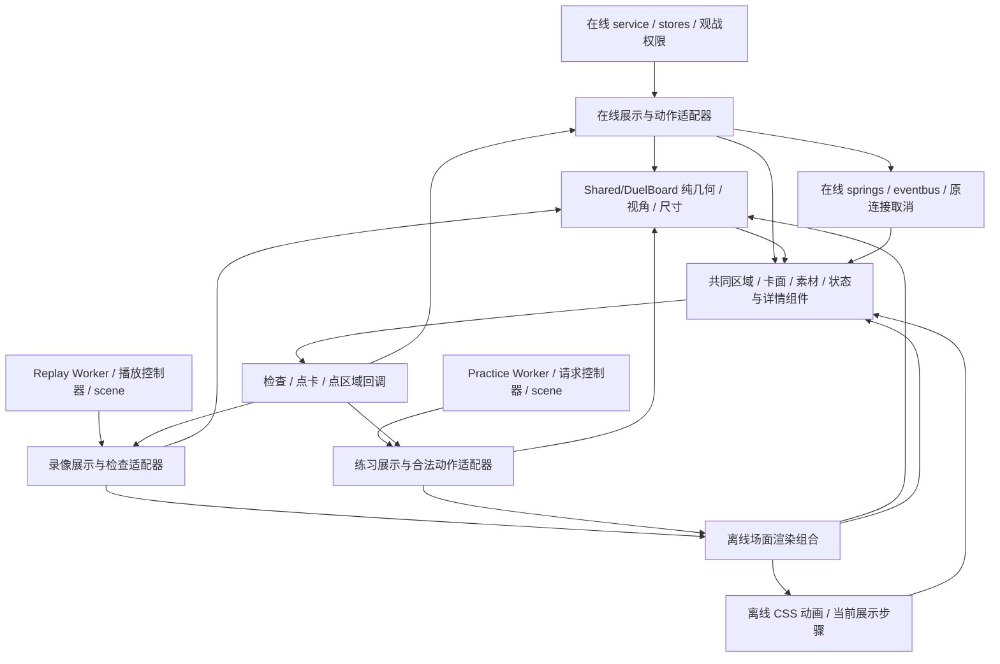
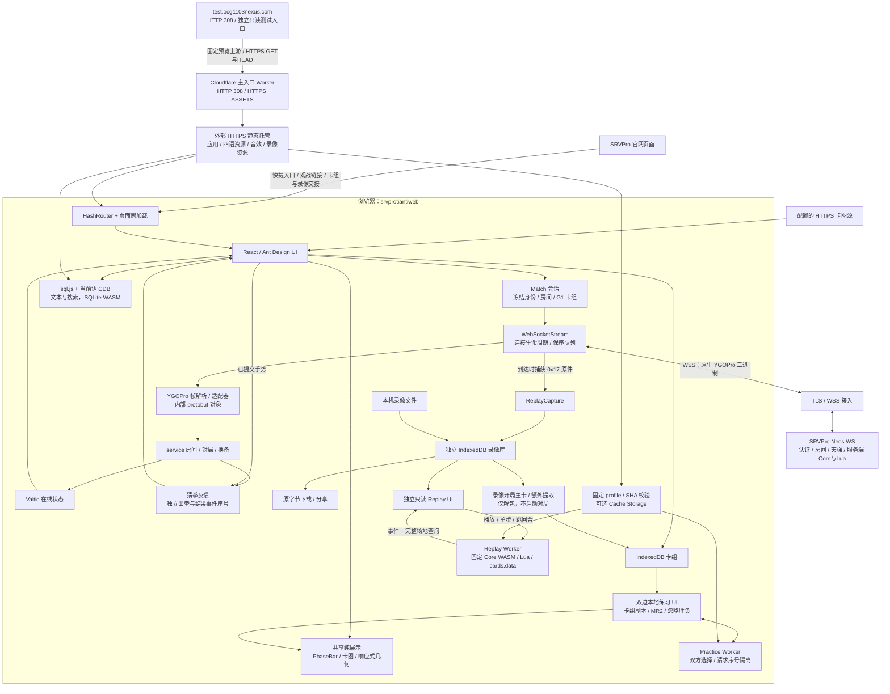
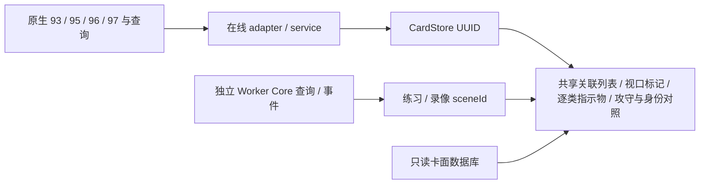
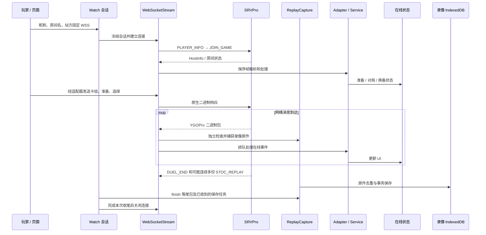
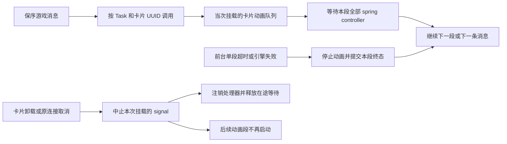
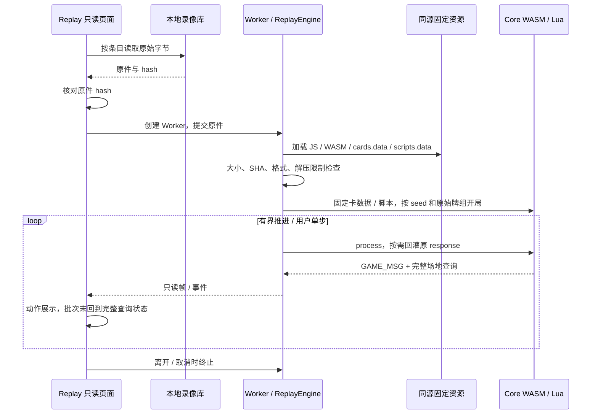
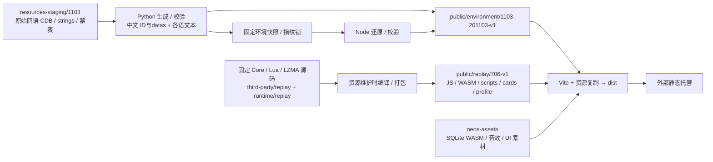

# 当前架构与数据流

更新：2026-10-26。共享牌桌审查基线为 `cc678b662b279283b99d28039f3a9ba755662df4`，
已通过 GitHub 核对 `deploy/cloudflare`，与本地 `874871b9` 的文件树一致。
以下“共享牌桌重构方案”是待实施设计；其余章节描述现有实现，不能把设计图当成已经完成的架构。
本文描述源码边界，不断言正式站点今天的部署版本。功能和测试状态见 [PROJECT_STATUS](PROJECT_STATUS.md)，
设计理由见 [设计文档](../YGOPro_706_Web_Client_Design.md)。

## 共享牌桌重构方案

状态：阶段一审查与设计已完成，等待用户确认；尚未修改产品代码或部署。2026-10-26 用户明确要求先交付文档，确认后再改代码。目标是相同的展示行为只有一个维护入口，
不以文件数量或代码行数作为验收。2026-10-25 用户明确选择：**录像也改为与联机相同的牌桌外观**。
录像的播放工具、列表视图、检查时暂停、缩放和视角功能继续保留。

### 基线与并行工作边界

- 原 `srvprotiantiweb` 工作树在 `codex/retain-join-passwords` / `6e0085d8`，包含大量未提交修改；不能用它代表当前全部功能，也不能清理或覆盖。
- 历史 `codex/client-preview-20261019` / `6ec3f013`、`codex/replay-phase2` / `2f3cb950` 只用于溯源；新方案基于已核对的 `cc678b66`。
- 本任务独立分支 `codex/shared-duel-board-20261025`，工作树位于 `F:/MyCardLibrary/srvpro/.audit-tmp/web-shared-board-20261025`。
- `xyz-side-repair-20261024` 另有未提交的换备和素材样式修复，不复制、不提交进本批。正式合入前须检查它届时的合入状态和冲突；需要的已完成修复应按明确提交集成，不能扫描所有脏文件。
- 仅授权完成后的固定测试预览。正式分支合入、正式发布、服务器配置、业务数据、进程重启不属于本任务。

### 当前三个模式的真实关系

| 维度 | 联机与观战 | 录像 | 本地练习 |
| --- | --- | --- | --- |
| 裁定与数据 | 服务端 Core；WSS 原生包经 adapter/service 更新在线 Valtio stores | 独立 Replay Worker/Core 回灌录制响应，返回 `ReplayFrame` | 独立 Practice Worker/Core，`PracticeFrame` 当前扩展 `ReplayFrame`，额外携带请求 |
| 状态与身份 | Container + `cardStore` UUID、`matStore`、`placeStore`、请求所有权 | 页面播放状态、`SceneCard.sceneId`、单批步骤队列、播放代次 | `usePracticeSession`、独立请求 id/玩家/Worker 代次、场面及选择草稿 |
| 消息节奏 | `stream → executor → onSocketMessage → gameMsg → handler → eventbus → springs` 保序等待；到包计时确认和录像捕获独立 | `ReplayEngine.next` 后用 `sceneSteps` 逐步呈现，批末完整查询校准；暂停/单步/跳转改变控制器节奏 | `presentation` 已复用 `sceneSteps/seedScene`，`materials` 增加素材收集步骤；用户响应只送本地 Worker |
| 场地与手牌 | `Mat/Bg` + SCSS；Card springs 内计算卡片目标坐标、手牌扇形、堆叠和旋转 | `FieldBoard` + `scenePoint` 独立固定坐标，桌面行坐标换算、直排手牌、CSS 动画 | `Board.point` 重算扇形、区域、镜像和旋转；已借在线 `matConfig`、Bg 样式、`materialOffset` |
| 卡图/状态 | `YgoCard`，在线 Card 动画与交互外壳 | 场地和列表使用 `ReplayCardTile`，独立 img/状态外壳 | `YgoCard`，本地按钮/菜单/选择外壳 |
| 素材 | 单独在线卡片 UUID，宿主位置 + overlay sequence | 当前主要数量、详情和场面数据，尚无在线等效的逐张素材外壳 | 已有素材 fan，保留宿主实例和独立 overlay index；素材逐张收集、宿主最后出现 |
| 装备/对象/指示物 | 在线消息按 UUID 更新，`onlineInformationCards` 负责可见性投影 | `sceneInformationCards` 投影 sceneId 与查询/事件关系 | 与录像共用 scene 信息层及取对象生命周期 |
| 输入与选择 | Card/Bg 可触发 CTOS；`actionRequest` 保护确认/过期/单次提交；观战限制独立 | 只检查卡片/牌堆并暂停，无用户规则响应 | Core 合法候选经 `interactions` 与 `Choices` 路由，双方请求由用户处理 |
| 详情/历史/阶段 | CardModal 订阅在线 liveCard；historyStore；PhaseBar | 页面 Drawer 组装详情；原始事件历史；播放进度/阶段展示 | 页面 Drawer 重复部分详情；最近 500 条 SceneAction 历史；已复用 PhaseBar |
| 手机/桌面 | Mat 测量、CSS media query、DuelPanel 与操作栏 | 自有可用高度/一屏适配/缩放/滚动与 Drawer | 自有测量/缩放/侧栏及竖屏动作优先，部分规则与联机相同 |

关键源码入口：[在线 Mat](../src/ui/Duel/PlayMat/Mat/index.tsx)、[在线 Card](../src/ui/Duel/PlayMat/Card/index.tsx)、
[在线几何](../src/ui/Duel/PlayMat/css.ts)、[在线手牌](../src/ui/Duel/PlayMat/Card/springs/moveToHand.ts)、
[录像场地](../src/ui/Replay/FieldBoard.tsx)、[录像 scene](../src/ui/Replay/scene.ts)、
[练习场地](../src/ui/Practice/Board.tsx)、[练习展示](../src/ui/Practice/presentation.ts)、
[练习会话](../src/ui/Practice/usePracticeSession.ts)。

目录名称不是重复的证据。已经共享的 `InformationCard/CardInformationLayer`、`CardStats/CardIdentity`、
`FieldSelectionGrid`、`PhaseBar`、`materialOffset`、固定资源加载器与 scene 步骤应继续使用。
`PracticeFrame extends ReplayFrame` 是现有类型复用，不表示两者可共享请求或 Worker 生命周期。

### 重复清单与收益评估

| 可共享能力 | 已核实问题/收益 | 复杂度/风险 | 本次处理 |
| --- | --- | --- | --- |
| 布局参数、卡位、手牌和素材几何 | 在线 springs 与 Practice.point 重复公式；Replay 再维护一套坐标。改一处应同时作用三个模式 | 中/高：远端镜像、守备、素材层级、MR4+ 区域 | 提取纯几何，以在线牌桌为基准，三个模式全部接入 |
| 场地缩放和测量 | 三处 ResizeObserver/尺寸计算；练习调用 `updateMatLayout` 还会写全局 `matConfig` 与 body CSS | 中/中：横竖屏、短窗口、同屏隔离 | 共享测量和 fit 算法；可用空间与录像 zoom 留给页面容器 |
| 区域背景、牌堆角标、卡面与通用状态 | 同义渲染分散；Replay 仍直接 img，难同步 YgoCard 的目标/失效标记 | 中/中：点击区域、44px 控件、保密与叠层 | 共享无状态组件，迁移三种入口；模式控制器只传数据与回调 |
| 装备/目标/指示物/攻守层 | 已有中立 `InformationCard` 和纯展示层 | 低/高：保密字段、实例对应、定位 | 沿用现有层，补适配契约与回归，不建立第二套状态 |
| 详情内容 | Replay/Practice 重复卡图、身份、攻守、正文及关联组装；在线有相同内容但 liveCard 订阅不同 | 中/中：隐藏卡/里侧、语言刷新 | 抽公共内容，保持三个打开/关闭/跟踪控制器 |
| 选择框、阶段栏 | 已有共享网格/PhaseBar，实际差异是在线请求和本地请求 | 低收益/高风险（若合并控制器） | 延用共享显示；不合并提交、取消、确认和草稿寿命 |
| 历史 | 在线公开事件、录像原始事件、练习 SceneAction 的来源与回溯含义不同 | 中/高 | 维持各自存储及格式路径，复用已有卡名/详情展示，不强行统一历史模型 |
| 动画 | 在线 react-spring 的完成承诺与离线 CSS/scene 时间控制不同 | 高/高 | 共享目标 pose、卡面、素材及标记；保留动画驱动与完成/取消边界 |

### 方案取舍

1. 直接统一在线 Mat/Card/handler：需要拆出其全局 store、WSS、请求与取消依赖，容易改变观战和玩家等待；不采用。
2. 共享底层展示，暂留录像旧布局参数：风险较低，但用户已选择录像也统一为联机外观，本次不保留第二套录像布局。
3. **采用：共同牌桌几何和组件 + 独立模式适配器/控制器。** UI 层逐段迁移，运行机制不变；录像改用同一牌桌，播放壳继续独立。不是一个包含大量 `mode === ...` 的巨型组件。

### 目标依赖与契约

下面是待实现图，不替代后文的当前运行时图：

实现位置优先为 `src/ui/Shared/DuelBoard/`（命名可由实现者细化），不新增第三套业务 store。

- **几何：** 输入只含规则、布局尺寸、玩家/区域/原始 sequence、视角、手牌数量、姿态及素材序号；输出 x/y、宽高、旋转和层级。中心坐标、CSS 变量和区域边框必须来自同一份几何。在线枚举与 Core 位掩码由适配器转换，不能直接混用数字枚举。
- **单一布局：** 以现有在线 `matConfig` 和区域规则为基准，保留其横竖屏布局及 MR4+ 额外怪兽区支持；Replay/Practice 使用实际固定 profile 的 MR2。不借本次扩大可播放格式或规则支持。移除 Replay 的 `scenePoint`/桌面 rows 专用视觉算法以及 Practice 的本地扇形计算。
- **实例隔离：** 纯布局计算不读 store、不写 DOM；每个牌桌根节点应用自己的变量。现有全局常量可保留给非牌桌卡图，但离线测量不得修改在线可变几何。若暂保在线 `matConfig` 兼容包装，只允许在线适配器更新；所有目标 pose 仍委托共享函数，不再保留副本公式。
- **展示投影：** 复用 `InformationCard`、`FieldSpot` 等现有概念，仅新增渲染所需的稳定 id、卡位、可见卡号/卡背、姿态、素材和已格式化标签/动作可用性。它不是统一裁定状态，不包含 socket、Core、响应编码或请求处理器。UUID/sceneId 由来源适配器提供；素材用宿主实例 + overlay index 区分，同名卡不合并。
- **可见性：** 在线适配器在进入共享层前执行既有手牌/盖牌/翻转牌顶策略；不向 DOM 属性、可访问名称、title 或详情传入未知身份。录像沿用 reveal，练习双方可见。点击共享组件本身不能提升信息权限或产生规则响应。
- **事件：** 通用组件仅回调卡片实例/原始区域地址。在线回调继续走 `actionRequest`；练习继续校验 Worker 代次、请求对象/id 和真实玩家；录像只检查/暂停。视角仅改变画面，不重写原始 response index/控制者。
- **动画：** 在线保留原连接 signal、挂载队列、全部 spring controller 完成等待与逐消息 await；不加队列跳帧或取消玩家等待。离线保留一批 scene 步骤、批末 Core 查询校准、稳定实例和素材收集时序；跳转/重开清掉旧步骤和展示标记。先共享目标位置和视觉构件，不替换动画引擎。
- **布局容器：** 牌桌区域/卡面相同；联机聊天及选择栏、练习操作栏、录像进度/工具栏继续独立。录像保留 1×/1.5×/2× 缩放、恢复大小、主动放大后的滚动、列表回退和点击暂停；默认适配时完整显示牌桌。
- **详情/语言：** 公共内容接收已获准查看的卡片、当前四语资料、动态攻守/身份/关系；弹层开关和实时跟踪不进入公共内容。切语言不重连、不重开 Worker、不重置待选草稿。优先现有文案，本次不扩展设置或玩法。

不要求所有模式使用同一个顶层 React 组件。必须共享真正的坐标计算、区域样式/构件、卡面与状态内容；
不能只包一层公共组件，内部仍保留三份算法。离线 SceneBoard 可以复用现有练习渲染拆出的组合，
但不能导入 Practice 请求解析，也不能使用在线 Card/Bg 的有副作用入口。

### 实施顺序与可回滚边界

1. **基线与回归约束。** 记录已有失败；修复有证据的测试契约偏差，再保存在线/练习原有布局及交互断言。录像旧像素断言按已确认的新外观替换，播放行为断言保留。
2. **共享几何。** 从现有在线公式提取纯布局/坐标/素材函数，在线 springs 委托，练习去掉复制的 point；移除离线写 body/在线可变配置的路径。保持在线视觉与时序。
3. **共享区域及卡片内容。** 从现有 Bg/YgoCard/练习按钮抽无状态构件，保留在线和练习动作包装器；把详情公共内容接入已有三种弹层。每次抽取后跑受影响回归。
4. **录像接入同桌。** 用同一几何与场面构件替换 FieldBoard 的独立卡位/卡面，保留播放壳、步骤、动画方向、视角、reveal、缩放、牌堆检查及列表视图。仅移动确属公共的场面展示类型/函数，必要的旧导出可短期兼容，不能复制实现。
5. **整体验证与测试发布。** 类型/lint/构建、Core、浏览器矩阵通过后提交明确文件集，更新固定预览，核验部署元数据和用户可见行为。按几何、构件、录像迁移划分提交，便于定位与回退。

本次必须交付第 2–4 步的共同维护入口。未统一的动画引擎、历史控制器、模式 shell 均有上述机制理由；
不能只完成参数提取就宣称三个模式的共享架构验收通过。若实测证明某一步回归成本超出边界，先报告证据和缩减方案。

### 风险与验收矩阵

| 风险/验收内容 | 自动化证据要求 | 人工补充 |
| --- | --- | --- |
| 同一处修改影响三模式 | 新增共同样例挂载在线/录像/练习，核对相同规则/尺寸/视角下区域和 pose；只调整共享几何夹具，验证三者同时变化且状态互不污染 | 三入口并排比较卡位/手牌/牌堆/素材外观 |
| 在线完整流程与隐私 | 本地 WSS/合成包验证创建房、入场、召唤/盖放/翻转/连锁、选择、观战、Match/换备；`test:animation-lifecycle`、`test:animation-ui`、`test:duel-action-request`、`test:side-ui`、房间/选择脚本 | 使用专门测试身份完成双人 Match、换备、观战及重连，不用真实玩家账号进行副作用操作 |
| 动画阻塞/取消 | 旧连接取消、卸载/重挂载、多个 spring 完成、玩家输入等待，保持 `test:duel-animation` 等断言 | 手机后台/恢复、较慢设备长队列的连续播放 |
| Replay 完整查询与播放 | 四份脱敏原生样本跑 `test:replay-runtime`、`test:replay-scene`；真实 Worker 的加载/播放/暂停/单步/跳转/重开，另跑 field/state/confirmation/extract UI、倍速偏好和视角检查 | 已支持原件格式与真实录像观看；不把未知格式升级为支持 |
| Practice 真正合法动作 | `test:practice`、`test_practice_chain_xyz`、presentation、place/interactions/chain；真实 Worker 的召唤/发动/双方响应/重试和新种子 | 实际卡组操作、触摸选择和连锁确认 |
| 状态与实例 | card_information、card_stats、chain_target_presentation、material_layers 和目标选择脚本；同名卡、取素材 index、离区清理、牌堆顺序、隐藏卡 DOM/详情不可泄露 | 装备、多目标、指示物、素材较多的实际局面 |
| 语言/响应式 | 中英日韩 × 桌面 1280×800、1920×1080、竖屏 390×844、窄屏 320×640、横屏 844×390；鼠标/模拟触屏；录像额外测短桌面/缩放，布局调整不丢草稿 | iOS Safari 与 Android 真机的点按、滚动、旋转、弹层关闭 |
| 会话隔离 | 三模式往返、同时挂载测试，离线零 WSS、在线 store/布局不被离线写入、旧 Worker 回包无效、语言切换保留请求 | 保留卡组草稿与浏览器原件，刷新/返回后的正常体验 |

仅已有测试脚本存在，不代表本轮通过。2026-10-25 在原样 `cc678b66` 隔离树执行
`node scripts/test_replay_scene.mjs`：首次被沙箱子进程 `spawn EPERM` 阻断，获工具审批后执行，
在 `Every batch settles to exact full Core query` 断言失败；首个差异为展示层新增的
`targeted/targetFlash/equipTarget/cardTargets`。现断言只剥离 `sceneId`，与 `scene.ts` 的投影不匹配。
实施时应明确比较完整 Core 字段并独立断言展示关系/目标生命周期；不能删掉这些展示字段或宽泛跳过断言。
随后仅在忽略目录生成诊断副本，明确剥离上述四个展示字段及 `sceneId`，保持原测试和产品源码不变；
四份脱敏录像的 2,090 批、2,923 个展示步骤通过完整查询比较、既有帧不变及既有动作断言。
这支持“测试混淆 Core 字段与展示字段”的原因判断，不表示原回归已修复，也不证明全部展示状态正确。
正式修改仍需保留所有 Core 字段比较，并单独验证对象/关系等展示字段。尚未执行本轮完整构建/浏览器回归。

文档本身已检查本地文件链接与 `git diff --check`；独立实施者审查未发现影响制定施工计划的关键缺项。

### 固定测试发布与交付

复用 [现有发布链](cloudflare-ci.md#固定测试入口与-wss)；目标为 `https://test.ocg1103nexus.com/`，
上游固定预览名 `codex-client-preview-20261019`。成功发布会覆盖先前测试预览，发布必须串行。

- 记录更新前测试版 `sourceCommit`，从本任务清洁提交构建；`SRVPRO_BUILD_TARGET=preview` + `build:cloudflare`，随后仅 `preview:cloudflare`。不得用 `deploy:cloudflare`，不推送或合并正式分支。
- 预览构建可读取正式站公开 `deployment-info.json` 中 WSS；不读私密配置、不修改游戏网关，不将静态预览成功称为完整联机验收。
- 等测试域名元数据报告目标 commit，再核对首页资源、录像/练习真实 Worker 和规定视口。需要联机人工验证时使用测试身份/房间，不影响正式玩家。
- 发布失败时保留可部署产物、来源 SHA 和配置要求；如需恢复，重新发布记录的前一测试提交到同一固定预览，不清理 IndexedDB 或玩家数据。
- 最终报告共同维护入口、仍独立的控制器及原因、自动化结果、基线失败处理、实际部署 SHA、手工清单与未知项。正式合入前重新审查其他开发分支的进展及冲突，并获得正式发布授权。

### 本轮交付与待确认内容

本轮只交付本节设计和状态页，原工作树及其他任务源码保持原样。用户已确认录像外观统一；
待确认的是整份施工范围：共同几何/区域/卡面/详情内容、保留三种控制器与动画驱动、
按上述顺序修复基线回归并迁移，最后仅发布固定测试预览。获得本次文档确认后才进入产品代码修改。

## 组件与数据归属

线上规则、账号、房间、计分、数据库与服务器录像目录属于 SRVPro。
网页是外部托管的静态应用，不增加账号或结算后端。SQLite WASM 读取卡片资料；
Core WASM 由录像播放、本地练习或压缩录像解包按需加载，二者不能按“WASM”合并判断。
官网交接与对战 WSS 是两条独立路径，导入卡组／录像不会自动入房。

`variant/webEntry` 解析公开 intent，`webEntrySession` 在资源加载前消费链接，并按现有运营来源名单完成一次性 postMessage 账号交接；`ui/WebEntry` 复用既有列表与 Match 表单，不引入新连接服务。带账号观战仅持久化完整身份、清空普通房间号，目标房间仍为临时输入；匿名入口继续恢复旧草稿。参数、来源校验和发送端示例见 [快捷入口](web-entry.md)。

阶段栏与原菜单共用 `variant/duelPhases.ts`，依据当前请求来源、回合归属与 Core 标志禁用不可进入的阶段。`PhaseState.command` 仅在 idle／battle 请求期间有效，提交、失效、新阶段或其他选择会清除；响应继续经过操作所有权及确认机制。区域内部数量角标由“画面与消息”的持久化 `showZoneCounts` 控制，不影响区域列表与主卡组保密。练习共享卡图、响应式几何与 `PhaseBar` 展示，保留独立 Worker、请求及状态，不复用在线 handler 或连接。

测试部署显式使用固定预览名称，保留同一 Origin 与浏览器存储。仅测试构建从正式站公开元数据读取当前 WSS；生产构建继续要求自己的显式环境变量。构建读取失败即中止，不写入陈旧地址。构建来源、共享入口覆盖关系与网关变更边界见 [自动部署](cloudflare-ci.md#固定测试入口与-wss)。

独立自定义测试入口只转发固定预览的静态 HTTP 请求；测试浏览器的 WSS 仍直接进入既有网关，Origin 精确白名单独立于静态入口。该 Worker 没有服务端游戏状态，也不修改正式根域名绑定；不同 Origin 的浏览器存储互相隔离。

Cloudflare 主入口先将 HTTP 以 308 跳转到相同主机、路径与查询的 HTTPS，再将 HTTPS 请求交给原有 ASSETS 绑定；独立测试入口在访问上游前同样跳转。主入口由 `wrangler.json` 的 `run_worker_first` 明确执行，不用会在 HTTPS 上循环的路径重定向。当前只随预览验证；正式站须以后合入发布分支才采用该入口。浏览器在跳转时保留 Hash 路由，但 HTTP 与 HTTPS 的本地存储仍互相隔离。

`service/mora/feedback.ts` 将实际提交的手势与收到的胜负结果分开计数，由 Layout 中唯一 `RpsFeedback` 展示；相同平局仍是新事件，不依赖手势值是否变化。`hidePlayerIds` 仅作用于显示层，固定八个星号，不改房间原名、身份、缓存或录像。非空主／额外牌堆的数量角标深度取当前叠牌高度之上，仍归原区域和同一开关。练习双方牌堆允许完整查看，在线主卡组保密约束继续保留；位置 count=0、选择面板路由和验证契约见 [本地练习](practice.md)。

在线 `MSG_REVERSE_DECK`／`MSG_DECK_TOP` 沿用原始二进制消息，经本地 adapter 扩展交给 service 更新 CardStore，不改固定 protobuf 或线上规则。整副翻转与单卡翻转独立；公开卡号单独记录，不能因翻转把隐藏缓存身份变成公开信息。联机和练习的素材仅共享扇形几何，依旧分别读取在线 CardStore 与本地 Core 查询。练习展示事件去重和最近操作历史保留在练习会话内；既有架构图的模块／连接边界不变。

| 模块责任 | 实际入口 | 维护边界 |
| --- | --- | --- |
| 应用与路由 | [main.tsx](../src/main.tsx)、[NeosRouter](../src/ui/NeosRouter.tsx) | HashRouter、页面懒加载、当前可达入口；源树残留上游文件不等于启用功能 |
| 联机会话 | [Match/util.ts](../src/ui/Match/util.ts)、[socket.ts](../src/middleware/socket.ts)、[stream.ts](../src/infra/stream.ts) | 冻结输入／原卡组、建立连接、恢复与退出 |
| 表单与恢复判断 | [joinForm.ts](../src/variant/joinForm.ts)、[connectionResume.ts](../src/variant/connectionResume.ts) | 完整输入缓存、主动清空、服务端恢复通知、阶段确认 |
| 协议转换与执行 | [packet.ts](../src/api/ocgcore/ocgAdapter/packet.ts)、[executor.ts](../src/service/executor.ts)、[onSocketMessage.ts](../src/service/onSocketMessage.ts) | 帧边界、内部对象、保序处理；不能直接作为只读 Replay handler 复用 |
| 在线状态与显示 | [stores](../src/stores/)、[container](../src/container/)、[duel service](../src/service/duel/)、[Duel UI](../src/ui/Duel/) | Valtio 与在线交互，部分 service 直接引用全局 store |
| 固定环境／部署／语言 | [variant/index.ts](../src/variant/index.ts)、[deployment.ts](../src/variant/deployment.ts)、[languageLink.ts](../src/variant/languageLink.ts) | WSS、资源路径、部署命名空间、来源白名单和语言优先级 |
| 卡库与字符串 | [sqlite](../src/middleware/sqlite/index.ts)、[cards.ts](../src/api/cards.ts)、[strings.ts](../src/api/strings.ts) | 当前语文本与搜索；候选资源就绪后再切换 |
| 本地卡组 | [deckStore.ts](../src/stores/deckStore.ts)、[BuildDeck/store.ts](../src/ui/BuildDeck/store.ts)、[deckImport.ts](../src/service/deckImport.ts) | IndexedDB、解析与编辑草稿；接收权限与字段见专题 |
| 原始录像 | [capture.ts](../src/replay/capture.ts)、[library.ts](../src/replay/library.ts) | 到达时捕获、hash 去重、原件／条目／会话关联；存储失败提示 |
| 只读重演 | [worker.ts](../src/replay/worker.ts)、[engine.ts](../src/replay/engine.ts)、[Replay UI](../src/ui/Replay/index.tsx) | 固定资源、响应回灌、事件与完整查询；独立在线状态 |
| 离线运行时与提取 | [runtime.ts](../src/replay/runtime.ts)、[extract.ts](../src/replay/extract.ts) | 共享 SHA 校验资源；提取保留原卡号顺序，不执行对局、不推测备牌 |
| 双边本地练习 | [practice](../src/practice/)、[Practice UI](../src/ui/Practice/)、[profile](../src/variant/practice.ts) | Worker 隔离、双方响应归属和过期请求取消；不触发联机连接或修改编辑草稿 |
| 重演展示 | [scene.ts](../src/ui/Replay/scene.ts)、[FieldBoard](../src/ui/Replay/FieldBoard.tsx)、[cardState.ts](../src/ui/Replay/cardState.ts) | 展示动作队列，每批末回到 Core 查询 |
| 固定协议来源 | [protocol-source](../protocol-source/README.md)、[生成 IDL](../src/api/ocgcore/idl/) | 保留来源 commit／许可证，日常构建不执行 protoc 或初始化 submodule |

## 卡片持续信息

原生装备与持续目标、按类型指示物沿各自规则状态通道进入展示层，清理与隐私约束见 [卡片持续信息契约](duel-results.md#持续关联与按种类指示物)。界面不从连锁对象、卡名或无效状态推测持续关系。

攻守／身份的当前值、原本攻守与卡面资料保持独立，查询省略不覆盖既有原本值；未知值不由卡面猜测。三个模式共用详情格式与桌面空间测量层，效果正文保持卡面原文，协议能力边界见 [当前值与卡面值](duel-results.md#当前值与卡面值客户端测试版)。

操作面板左右位置、录像倍速与首次自动播放由 `settingStore` 规范化并持久保存。左右设置沿布局 CSS 变量和抽屉 placement 生效，不触碰联机连接或 Core 请求；倍速与播放页双向同步，首次自动播放使用一次性标志，不能复活暂停或后台状态，详见 [面板位置](mobile-ui.md#操作面板左右位置客户端测试版) 和 [录像偏好](replay-usage.md#录像播放偏好客户端测试版)。

## 在线消息、会话与录像收尾

卡组草稿的三区数组保存用户指定的顺序。`editDeckStore.add` 只追加，`reorder` 按区域内
源／目标下标移动，移除也可指定位置以区分重复卡片；只在用户主动自动排序时重排。
复制卡片与搜索加入共用 `canAdd`，移动保留原有的数量抵扣。保存、导出与联机入场沿用
相同数组顺序与原存储／协议格式。桌面卡图和手机独立手柄的交互见 [手机界面](mobile-ui.md)；
编辑器禁表筛选按当前禁表的 0／1／2／3 类别过滤搜索结果；忽略禁表仅改变编辑器加入判定，仍按 alias 归并同名卡且合计最多 3 张。切回限制保留现有卡片和顺序，仅提示不合规；在线卡组检查仍由服务端完成。设置统一保存智能连锁初值、随机出拳策略和音效，房内快捷状态双向同步。横屏几何由同一份数值同时驱动 CSS 与卡片动画，旋转不重建在线选择。

WSS 上传输 `uint16LE length + uint8 opcode + payload`，length 包含 opcode，
没有额外 JSON、Base64 或 protobuf 封装。适配器处理粘包／半包和边界；protobuf 只作为内部类型。
原始录像在网络到达时捕获，独立于可能等待动画的消费路径。
双人 `TIME_LIMIT` 的合法完整包也在到达时按实际玩家身份与 controller 发送 `TIME_CONFIRM`，
不等待动画、选择或结果弹窗；界面只按原队列更新时间。Tag 保留原确认路径。
这不提前开放恢复操作，也不重发旧响应或换备提交，见 [掉线排查](connection-stability.md)。
收尾时间有界，未收到的录像不能补录；具体等待和下载边界见 [录像使用](replay-usage.md)。

昵称密码与房间密码分别发送到 `PLAYER_INFO.name`／`JOIN_GAME.pass`，房间字段保持原样。
首次无缓存房名预填 TT，但主动清空不会被 TT 覆盖。会话建立后输入变化只用于下一次主动入场。
恢复需要可信宿主通知和确认，使用冻结的 G1 原始 UPDATE_DECK，不能用当前换备卡组替代；
刷新只回填输入，需手动入房和选原卡组。具体阶段、观战和计时见 [会话恢复](session-recovery.md)。

**累计队列保持现状：** `stream.ts` 入队，`onSocketMessage.ts` 保序等待处理。
单次消息 2 MiB 和半包缓冲 65,537 字节限制不限制累计队列。
用户于 2026-10-10 决定暂不实施 B，保留连续动画，接受长时间后台／慢消费的积压；
累计队列上限与历史演出策略保持不变，连接确认时序独立于展示队列。这个决定与只读录像展示队列是不同事项。

在线手牌确认后的临时身份由 `CardType.confirmedHandCode` 持有，只有选卡元数据读取它；
场地仍按服务器 `code`／`meta` 展示。洗手牌、移动、连锁结束与回合切换清理，场面重建
丢弃旧卡片实例，不落入浏览器存储或 Replay 状态。消息顺序及 UI／service／store 关系
沿用上图，具体选卡与隐藏边界见 [在线结果](duel-results.md)。

卡片动画仍是保序 service 的展示等待，取消范围属于卡片当次挂载及其原连接：

`eventbus.ts` 只保留未完成调用的释放函数，完成或失败立即移除；缺失卡片立即返回，
同类动画各自完成，不共享结束事件。`Card/springs/utils.ts` 保留前台单段 3 秒截止和后台暂停；
引擎异常只降级当前展示，终态提交也失败则交给传输错误边界关闭连接，不继续应用不确定状态。
玩家选择弹窗仍按原协议等待输入；本机制不为交互添加截止、不替玩家提交响应。
具体复现和验证边界见 [动画稳定性排查](connection-stability.md#动画与消息等待审计2026-10-25)。

## 离线录像重演

固定 `706-v1` profile 与 SHA 锁保护重演环境，但录像头不能证明生产 Core／Lua 全部版本。
标准双人 YRP2／UNIFORM `0x1362` 扩展头 1 是当前支持格式；其他格式可保存／下载。
响应耗尽或不兼容时如实停止，不补造胜负。切视角、暂停和场地动画只影响展示；
不运行在线选择 handler，不向 WSS 发送响应。详细格式和已有样本见 [录像使用](replay-usage.md)。

## 配置优先级与存储

| 项目 | 当前规则／归属 |
| --- | --- |
| WSS 地址 | 公开 `window.__SRVPRO_DUEL_CONFIG__.duelWebSocketUrl` 存在时优先于 `VITE_DUEL_WS_URL`，显式空值禁用联机；玩家不能编辑地址 |
| 交接来源 | `deckImportOrigins` 是站方精确 Origin 白名单；参数只能选择允许来源，不能扩大白名单。消息还要校验 source／request／版本／负载 |
| 语言 | 有效 Hash `lang` → 网页 query `lang` → 已存选择 → 支持的浏览器语言 → en；初始化前捕获，切语不重连 |
| 资源地址 | `BASE_URL` 形成 `environment/1103-201103-v1` 与 `neos-assets` 路径；卡图源集中配置，不接收玩家任意 URL |
| 完整联机输入 | 内存草稿与当前标签页 sessionStorage；普通退出保留，主动清空和一键观战清空按会话契约执行 |
| 公开偏好 | localStorage 的语言、公开昵称／房名等，不含账号或房间密码 |
| 卡组 | 卡组 IndexedDB 与编辑 store；不会随观战输入清空而删除 |
| 录像 | 独立 IndexedDB 的 blobs／entries／occurrences，原件 hash 去重；失败时有限临时内存并提示备份 |
| 录像资源缓存 | 可选 Cache Storage，与玩家卡组／录像原件分开；不可当作玩家数据备份 |
| BiliToy 命名空间 | 同作品版本更新共享、不同作品隔离；普通站点仍按浏览器 origin 分隔 |

换网站 origin、浏览器或清除站点数据前导出玩家数据。
卡组／录像接收的限额、精确字段和消息时序分别归 [卡组契约](deck-import.md)／[录像契约](replay-import.md)，
观战权限由宿主决定，入口参数归 [观战契约](room-spectator-links.md)。

## 资源构建与发布

| 路径 | 用途／前置 |
| --- | --- |
| `npm run build:static` | Node 从固定快照恢复环境、校验录像资源、Vite 构建与复制；不要求 Python、Emscripten、protoc 或 git submodule |
| `npm run dev`／`npm run build` | 使用 Python 生成环境资源；适合修改生成规则和开发调试 |
| `npm run build:cloudflare` | 发布构建包装，共同校验公开 WSS／官网 URL／卡组与录像来源白名单，走静态构建并写版本信息；固定快照与录像资源随仓库提供 |
| Python 两种发布包 | 普通包从 `dist` 复制，Toy 包单独构建；均调用同一公开配置校验器，支持迁址白名单与官网入口参数，见 [公开配置](public-deployment-config.md) |
| 维护原始环境输入／快照 | [资源审计](1103-resource-audit.json)、[原件说明](../resources-staging/1103/README.md)、[还原脚本](../scripts/restore_environment_assets.mjs)；原件字节不变，生成规则／revision／指纹一起维护 |
| 维护录像 Core／Lua | [脚本维护](replay-script-maintenance.md)、[profile](../src/replay/profile.json)；需要原生／WASM 编译工具，普通试用不用执行 |
| 维护协议 IDL | [固定来源说明](../protocol-source/README.md)；来源、许可证、指纹和生成 TS 一起更新 |

发布仅将构建产物放在外部静态站点；静态文件不经天梯服务器中转。
`deploy/cloudflare` 更新会触发已配置的生产构建，发布验证与回退归 [自动部署](cloudflare-ci.md)。
图中是当前构建职责，不是全新 Linux 服务端部署／数据恢复指南。

模块、配置、存储或数据流变化时同步本文；局部 UI 和协议字段只维护所属专题。
