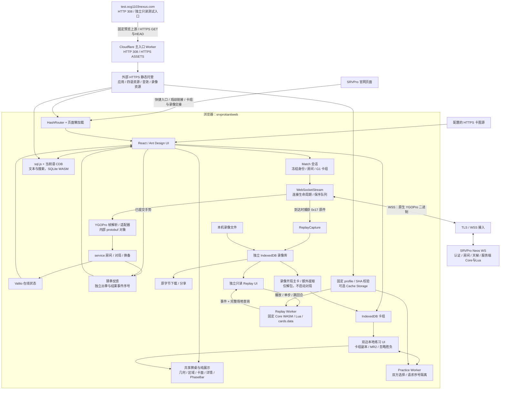
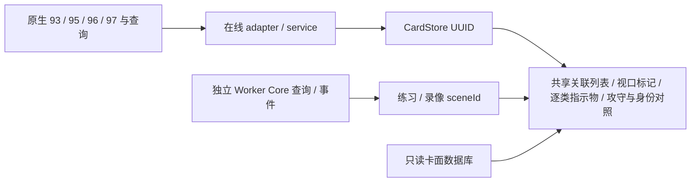
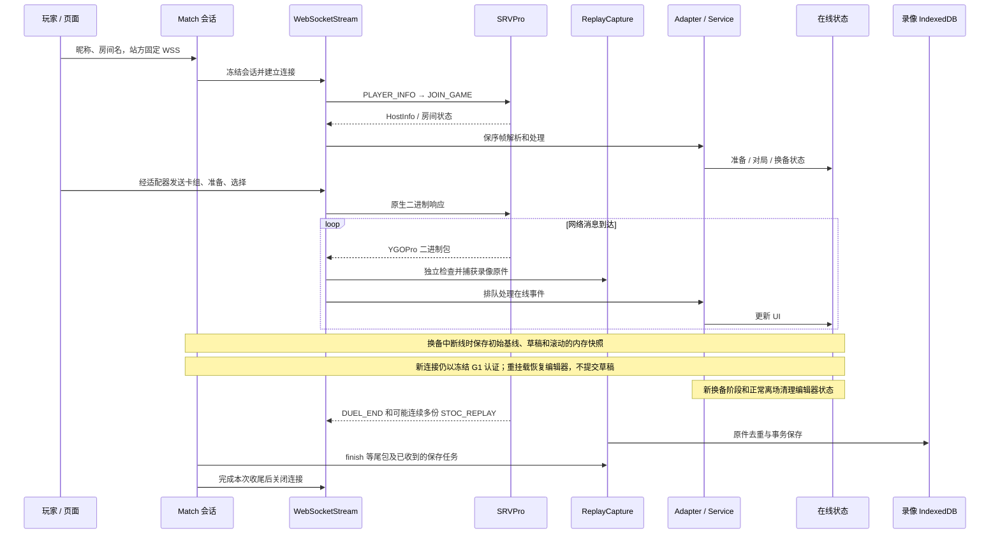
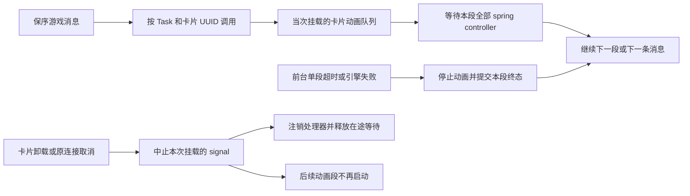
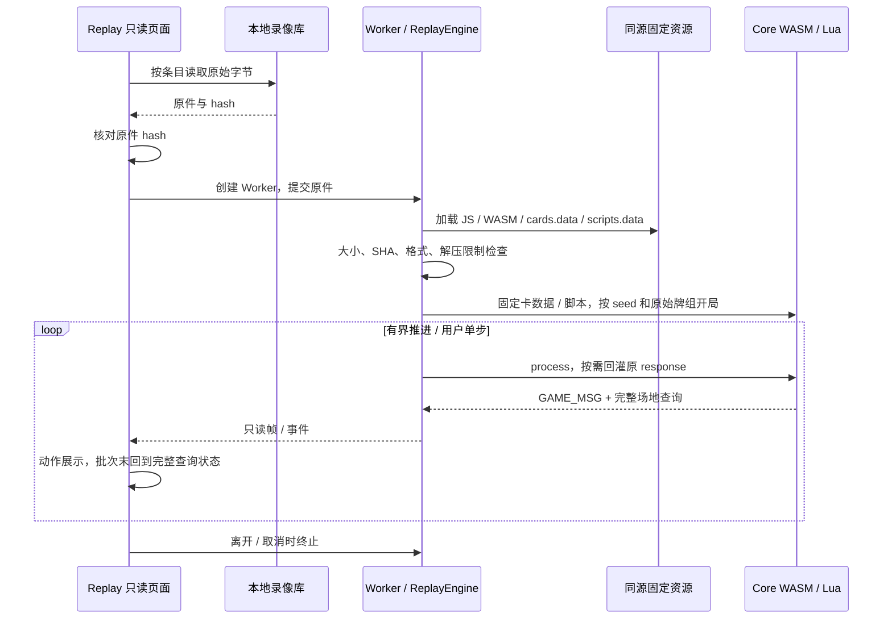
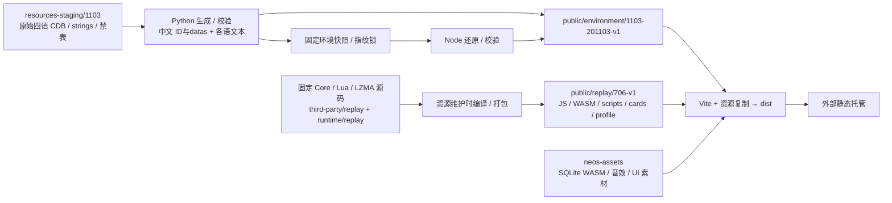

# 当前架构与数据流

更新：2026-10-26。本文描述源码边界，不断言正式站点今天的部署版本。功能和测试状态见 [PROJECT_STATUS](PROJECT_STATUS.md)，
设计理由见 [设计文档](../YGOPro_706_Web_Client_Design.md)。

## 共享牌桌

联机／观战、录像和测试手牌使用同一套牌桌几何与场面构件；三种模式各自保留数据来源、请求、动画驱动和外壳。
2026-10-25 用户确认录像改为与联机相同的牌桌外观，2026-10-26 确认实施范围并要求一次发布到固定测试版；正式合入另行授权。
实现基于 `deploy/cloudflare` 的 `db49ec6b`，分支 `codex/shared-duel-board-20261025`。

| 共享入口 | 内容 | 使用者 |
| --- | --- | --- |
| [geometry.ts](../src/ui/Shared/DuelBoard/geometry.ts) | 纯函数：布局参数（横屏／≥700×600 加大行距／MR4+）、区域外框 `zoneRect`、卡片姿态 `cardPose`（场地、手牌扇形、牌堆、素材扇形）、CSS 变量和适配缩放 | 在线 springs 与 `Bg`、`SceneBoard`、几何回归 |
| [ZoneBlock.tsx](../src/ui/Shared/DuelBoard/ZoneBlock.tsx) | 无状态区域块、牌堆数量角标、禁用叉号；样式在 [index.module.scss](../src/ui/Shared/DuelBoard/index.module.scss) | 在线 `Bg`、`SceneBoard` |
| [SceneBoard.tsx](../src/ui/Shared/DuelBoard/SceneBoard.tsx)、[BoardCard.tsx](../src/ui/Shared/DuelBoard/BoardCard.tsx) | 离线平面牌桌：区域、牌堆、连锁标记、素材扇形及练习素材收集暂存；卡片按共享姿态摆放 | 测试手牌、录像 |
| [CardDetail.tsx](../src/ui/Shared/DuelBoard/CardDetail.tsx) | 详情正文：卡图、攻守表、指示物、身份对照、关联卡片、卡面原文 | 在线 `CardModal`、练习与录像抽屉 |
| [scene.ts](../src/ui/Shared/DuelBoard/scene.ts)、[sceneInformation.ts](../src/ui/Shared/DuelBoard/sceneInformation.ts)、[cardState.ts](../src/ui/Shared/DuelBoard/cardState.ts)、[sceneWords.ts](../src/ui/Shared/DuelBoard/sceneWords.ts) | 离线场面步骤、Core 位置到牌桌位置的 `sceneSpot`、信息投影、表示形式与隐藏规则、四语动作文案 | 测试手牌、录像 |

在线 [boardSpot.ts](../src/ui/Duel/PlayMat/boardSpot.ts) 把在线区域枚举和控制者转为 `BoardSpot`；离线 `sceneSpot` 转换 Core 位掩码。
几何不读 store、不写 DOM。在线 [css.ts](../src/ui/Duel/PlayMat/css.ts) 仅是兼容层：`matConfig` 只由在线 Mat 更新并写入 body 变量；
离线牌桌各自计算几何并把变量写在自己的根节点，不修改在线布局。`Bg` 在 `neos:duel-layout` 时重算区域位置。

仍各自独立：

- **数据与请求：** 在线 service／stores 与 `actionRequest`；练习 Worker 请求与草稿；录像只检查并暂停。共享构件只回调卡片或区域。
- **动画：** 在线 react-spring、连接取消与逐消息等待不变；离线用 CSS 过渡及录像到达／离开动画（`translate` 叠加在共享姿态上，速度随倍速）。
- **外壳：** 联机侧栏、练习操作栏、录像工具栏／缩放／列表视图／牌堆抽屉。
- **可见性：** 在线进入共享层前已执行隐藏规则；录像沿用 reveal，练习双方可见。

在线牌桌的平面倾角为 0，离线牌桌不使用 `preserve-3d`，以 z-index 叠放（场地与素材在下、手牌在上），外观一致且避免旧 iPad 的 3D 合成开销。
响应式判断沿用与联机相同的视口查询（宽屏侧栏、≥700×600），作为参数传入几何；录像缩放只放大画布并滚动，不改变几何。
录像在桌面大屏不受 1.2 倍上限，保持占满可用区域；离线小牌堆以透明扩展区保持 44 px 宽的触控目标，纵向不越过相邻牌堆间隙。

卡片标注层（指示物、关联连线、卡下攻守）仅在牌桌 DOM 变化、尺寸或数据变化后测量，最多 30 ms 一次；
离线 CSS 卡片移动期间逐帧跟随，结束即停，忽略无限循环动画。

验证：`test:board-geometry` 以 1,200 个姿态用例核对共享几何与原在线公式完全一致（各布局、双方、素材层与牌堆），
并核对区域镜像与离线位掩码映射。`test:replay-scene` 比较完整 Core 字段，展示关系另行断言。浏览器回归、真机与完整联机状态见 [PROJECT_STATUS](PROJECT_STATUS.md)。

### 共享对局外壳

录像播放页与联机对局使用同一对局外壳（[DuelShell](../src/ui/Shared/DuelShell/)），双方只提供数据与按钮：

| 共享件 | 内容 | 联机 | 录像 |
| --- | --- | --- | --- |
| `SidebarFrame` | 宽屏侧栏（控件区、反馈位、记录标签与展开）；竖屏原位渲染；面板停靠所需的 CSS 位置变量 | 生命值、回合说明、操作菜单、记录／聊天 | 生命值、录像状态、录像菜单、操作记录 |
| `LifeBarView` | 双方名字、LP 动画、可选计时与附加行 | 在线状态与计时 | 当前帧 LP、手牌数，无计时 |
| `DuelBackground` | 对局底层，按“当前回合是否下方玩家”着色 | 在线回合／观战视角 | 当前帧回合玩家与视角 |
| `MenuFrame` | 工具栏容器、阶段条位置、侧栏两列网格；发布 `--duel-menu-height` | 联机按钮 | 录像按钮（只读阶段条） |
| `boardArea` | 牌桌区避开侧栏或上下栏 | `Mat` | `SceneBoard` |

在线计时、阶段响应、聊天和选择仍只在联机侧。录像侧栏在正常高度显示常用操作及跳到回合，其余（列表视图、恢复大小、下载、提取卡组、设置）与竖屏／短横屏的非常用操作一起放进“更多”面板；面板为停靠式，不用下拉菜单，短屏也能全部点击。
播放时隐藏网站顶栏（仅 `/replays?id=`，录像库保留），“退出播放”回到录像库并结束 Worker。旋转、切换列表视图或开关面板只改变布局，不重建 Worker，也不恢复播放（`test:replay-shell-ui`）。

### 共享操作记录

三种模式的操作记录使用同一行样式（[DuelHistory](../src/ui/Shared/DuelHistory/index.tsx)）：卡图可点开各自的详情，
操作图标与来源／去向区域（含格位，如“怪兽区 3”“额外怪兽区”“场地区”），每行带 `T回合 · 阶段 · 玩家` 标记。
回合开始与进入战斗阶段单独成行，其他阶段只在标记中体现；LP 增减与抽卡为文字行，宣言／结果和胜负沿用公告框。

| 来源 | 转换 | 卡片详情 |
| --- | --- | --- |
| 联机 `historyStore` | 处理函数写入时附带当前回合／阶段；新增回合、战斗阶段、LP、抽卡、表示形式、攻击与胜负，召唤／盖放记录目标格位；行内转换，store 条目保持引用以便逐行缓存 | `CardModal` |
| 录像 Worker 帧的原始 Core 消息 | [convert.ts](../src/ui/Shared/DuelHistory/convert.ts) `eventHistoryEntries` 按顺序行走，游标随回合／阶段消息推进，每帧末以帧回合校正；重新开始／回跳时清空 | 只读详情抽屉 |
| 练习场面步骤 | `sceneHistoryEntry`；攻击方卡号取自步骤卡片 | 练习详情 |

在线信息不变：对方里侧卡仍为卡背，不显示卡号。

“操作记录显示方式”为文字时（设置默认“自动”：手机界面文字、电脑图文），同一组件把每行改为一行文字：标记、卡名（仍可点开详情，里侧卡显示“里侧卡”）、操作、来源 → 去向；不加载卡图和图标。时间线按设置和 `useMobileInterface` 计算一次，经 context 传给已缓存的行，行本身不各自监听。

联机计时（[duelClock](../src/variant/duelClock.ts)）按 YGOPro 的 time_left／time_player：每方保存服务端剩余秒数与包到达时间（在 `ConnectionControl` 按网络顺序记录，不受动画队列延迟），只有服务端正在等待的一方倒数，显示由校准点与实际经过时间计算，定时器只负责刷新。每个 `TIME_LIMIT` 都重新校准（含与上次相同的 180 秒），我方提交响应即停表，新回合双方恢复为房间时限，重连后在服务端重新校准前不显示。SRVPro 心跳会发双方 0 秒的 `TIME_LIMIT`，只用于确认、不作校准。观战连接收不到 `TIME_LIMIT`，因此观战不显示计时。双方时间始终显示，计时方高亮，与回合高亮分开；圆环按房间实际时限计算。判负与补时仍以服务端为准。

卡图（[cardImageCache](../src/api/cardImageCache.ts)、`useCardImage`）：图源入口返回 `302 + no-store` 并跳转到不同的 CDN 节点，浏览器 HTTP 缓存经常重复下载同一张卡。最终图片允许 CORS，因此以入口地址（含图片语言）为键，把压缩文件存入 Cache Storage（`card-images-v1`）：最多约 600 张、先进先出，来源用量超过配额 60% 时停止写入；相同图片的并发请求合并，同时最多 8 个下载，失败的卡 60 秒内交给浏览器直接加载。运行时只保留引用计数的对象 URL 与 150 个空闲 URL，解码像素由页面元素负责。组卡卡片在进入滚动区域附近 400 px 内才加载。缓存不可用时回退到原地址；“画面与消息”可单独清理卡图缓存，不影响卡组、录像和联机输入。

联机音效（`audioContextManger.playEffect`）只使用一个效果 AudioContext 和缓存的解码结果，由任意点击／触摸／按键解锁；未处于运行状态时直接丢弃该音效，不排队。此前每个音效新建一个 context，iOS 在无手势时保持暂停，下一次触摸会把积压的音效一次播完，暂停的 context 也不会释放。最多同时 6 个声音，解码超过 600 ms 的音效丢弃。背景音乐不在此范围。

## 组件与数据归属

线上规则、账号、房间、计分、数据库与服务器录像目录属于 SRVPro。
网页是外部托管的静态应用，不增加账号或结算后端。SQLite WASM 读取卡片资料；
Core WASM 由录像播放、本地练习或压缩录像解包按需加载，二者不能按“WASM”合并判断。
官网交接与对战 WSS 是两条独立路径，导入卡组／录像不会自动入房。

`variant/webEntry` 解析公开 intent，`webEntrySession` 在资源加载前消费链接，并按现有运营来源名单完成一次性 postMessage 账号交接；`ui/WebEntry` 复用既有列表与 Match 表单，不引入新连接服务。带账号观战仅持久化完整身份、清空普通房间号，目标房间仍为临时输入；匿名入口继续恢复旧草稿。参数、来源校验和发送端示例见 [快捷入口](web-entry.md)。

阶段栏与原菜单共用 `variant/duelPhases.ts`，依据当前请求来源、回合归属与 Core 标志禁用不可进入的阶段。`PhaseState.command` 仅在 idle／battle 请求期间有效，提交、失效、新阶段或其他选择会清除；响应继续经过操作所有权及确认机制。区域内部数量角标由“画面与消息”的持久化 `showZoneCounts` 控制，不影响区域列表与主卡组保密。练习与录像共享牌桌几何、区域、卡面、详情和 `PhaseBar` 展示，保留独立 Worker、请求及状态，不复用在线 handler 或连接。

测试部署显式使用固定预览名称，保留同一 Origin 与浏览器存储。仅测试构建从正式站公开元数据读取当前 WSS；生产构建继续要求自己的显式环境变量。构建读取失败即中止，不写入陈旧地址。构建来源、共享入口覆盖关系与网关变更边界见 [自动部署](cloudflare-ci.md#固定测试入口与-wss)。

独立自定义测试入口只转发固定预览的静态 HTTP 请求；测试浏览器的 WSS 仍直接进入既有网关，Origin 精确白名单独立于静态入口。该 Worker 没有服务端游戏状态，也不修改正式根域名绑定；不同 Origin 的浏览器存储互相隔离。

Cloudflare 主入口先将 HTTP 以 308 跳转到相同主机、路径与查询的 HTTPS，再将 HTTPS 请求交给原有 ASSETS 绑定；独立测试入口在访问上游前同样跳转。主入口由 `wrangler.json` 的 `run_worker_first` 明确执行，不用会在 HTTPS 上循环的路径重定向。当前只随预览验证；正式站须以后合入发布分支才采用该入口。浏览器在跳转时保留 Hash 路由，但 HTTP 与 HTTPS 的本地存储仍互相隔离。

`service/mora/feedback.ts` 将实际提交的手势与收到的胜负结果分开计数，由 Layout 中唯一 `RpsFeedback` 展示；相同平局仍是新事件，不依赖手势值是否变化。`hidePlayerIds` 仅作用于显示层，固定八个星号，不改房间原名、身份、缓存或录像。非空主／额外牌堆的数量角标深度取当前叠牌高度之上，仍归原区域和同一开关。练习双方牌堆允许完整查看，在线主卡组保密约束继续保留；位置 count=0、选择面板路由和验证契约见 [本地练习](practice.md)。

在线 `MSG_REVERSE_DECK`／`MSG_DECK_TOP` 沿用原始二进制消息，经本地 adapter 扩展交给 service 更新 CardStore，不改固定 protobuf 或线上规则。整副翻转与单卡翻转独立；公开卡号单独记录，不能因翻转把隐藏缓存身份变成公开信息。三种模式的素材共享扇形几何，依旧分别读取在线 CardStore 与本地 Core 查询。练习展示事件去重和最近操作历史保留在练习会话内；既有架构图的模块／连接边界不变。

| 模块责任 | 实际入口 | 维护边界 |
| --- | --- | --- |
| 应用与路由 | [main.tsx](../src/main.tsx)、[NeosRouter](../src/ui/NeosRouter.tsx) | HashRouter、页面懒加载、当前可达入口；源树残留上游文件不等于启用功能 |
| 联机会话 | [Match/util.ts](../src/ui/Match/util.ts)、[socket.ts](../src/middleware/socket.ts)、[stream.ts](../src/infra/stream.ts) | 冻结输入／原卡组、建立连接、恢复与退出 |
| 表单与恢复判断 | [joinForm.ts](../src/variant/joinForm.ts)、[connectionResume.ts](../src/variant/connectionResume.ts) | 完整输入缓存、主动清空、服务端恢复通知、阶段确认 |
| 协议转换与执行 | [packet.ts](../src/api/ocgcore/ocgAdapter/packet.ts)、[executor.ts](../src/service/executor.ts)、[onSocketMessage.ts](../src/service/onSocketMessage.ts) | 帧边界、内部对象、保序处理；不能直接作为只读 Replay handler 复用 |
| 在线状态与显示 | [stores](../src/stores/)、[container](../src/container/)、[duel service](../src/service/duel/)、[Duel UI](../src/ui/Duel/) | Valtio 与在线交互，部分 service 直接引用全局 store |
| 固定环境／部署／语言 | [variant/index.ts](../src/variant/index.ts)、[deployment.ts](../src/variant/deployment.ts)、[languageLink.ts](../src/variant/languageLink.ts) | WSS、资源路径、部署命名空间、来源白名单和语言优先级 |
| 卡库与字符串 | [sqlite](../src/middleware/sqlite/index.ts)、[cards.ts](../src/api/cards.ts)、[strings.ts](../src/api/strings.ts) | 当前语文本与搜索；候选资源就绪后再切换 |
| 本地卡组 | [deckStore.ts](../src/stores/deckStore.ts)、[BuildDeck/store.ts](../src/ui/BuildDeck/store.ts)、[deckImport.ts](../src/service/deckImport.ts) | IndexedDB、解析与编辑草稿；接收权限与字段见专题 |
| 原始录像 | [capture.ts](../src/replay/capture.ts)、[library.ts](../src/replay/library.ts) | 到达时捕获、hash 去重、原件／条目／会话关联；存储失败提示 |
| 只读重演 | [worker.ts](../src/replay/worker.ts)、[engine.ts](../src/replay/engine.ts)、[Replay UI](../src/ui/Replay/index.tsx) | 固定资源、响应回灌、事件与完整查询；独立在线状态 |
| 离线运行时与提取 | [runtime.ts](../src/replay/runtime.ts)、[extract.ts](../src/replay/extract.ts) | 共享 SHA 校验资源；提取保留原卡号顺序，不执行对局、不推测备牌 |
| 双边本地练习 | [practice](../src/practice/)、[Practice UI](../src/ui/Practice/)、[profile](../src/variant/practice.ts) | Worker 隔离、双方响应归属和过期请求取消；不触发联机连接或修改编辑草稿 |
| 共享牌桌 | [Shared/DuelBoard](../src/ui/Shared/DuelBoard/) | 几何、区域、离线牌桌、详情正文与离线场面；不含请求或连接，见 [共享牌桌](#共享牌桌) |
| 重演展示 | [scene.ts](../src/ui/Shared/DuelBoard/scene.ts)、[FieldBoard](../src/ui/Replay/FieldBoard.tsx) | 展示动作队列，每批末回到 Core 查询；牌桌使用共享 `SceneBoard` |
| 固定协议来源 | [protocol-source](../protocol-source/README.md)、[生成 IDL](../src/api/ocgcore/idl/) | 保留来源 commit／许可证，日常构建不执行 protoc 或初始化 submodule |

## 卡片持续信息

原生装备与持续目标、按类型指示物沿各自规则状态通道进入展示层，清理与隐私约束见 [卡片持续信息契约](duel-results.md#持续关联与按种类指示物)。界面不从连锁对象、卡名或无效状态推测持续关系。

攻守／身份的当前值、原本攻守与卡面资料保持独立，查询省略不覆盖既有原本值；未知值不由卡面猜测。三个模式共用详情格式与桌面空间测量层，效果正文保持卡面原文，协议能力边界见 [当前值与卡面值](duel-results.md#当前值与卡面值客户端测试版)。

操作面板左右位置、录像倍速与首次自动播放由 `settingStore` 规范化并持久保存。左右设置沿布局 CSS 变量和抽屉 placement 生效，不触碰联机连接或 Core 请求；倍速与播放页双向同步，首次自动播放使用一次性标志，不能复活暂停或后台状态，详见 [面板位置](mobile-ui.md#操作面板左右位置客户端测试版) 和 [录像偏好](replay-usage.md#录像播放偏好客户端测试版)。

## 在线消息、会话与录像收尾

卡组草稿的三区数组保存用户指定的顺序。`editDeckStore.add` 只追加，`reorder` 按区域内
源／目标下标移动，移除也可指定位置以区分重复卡片；只在用户主动自动排序时重排。
复制卡片与搜索加入共用 `canAdd`，移动保留原有的数量抵扣。保存、导出与联机入场沿用
相同数组顺序与原存储／协议格式。桌面卡图和手机独立手柄的交互见 [手机界面](mobile-ui.md)；
编辑器禁表筛选按当前禁表的 0／1／2／3 类别过滤搜索结果；忽略禁表仅改变编辑器加入判定，仍按 alias 归并同名卡且合计最多 3 张。切回限制保留现有卡片和顺序，仅提示不合规；在线卡组检查仍由服务端完成。设置统一保存智能连锁初值、随机出拳策略和音效，房内快捷状态双向同步。横屏几何由同一份数值同时驱动 CSS 与卡片动画，旋转不重建在线选择。

WSS 上传输 `uint16LE length + uint8 opcode + payload`，length 包含 opcode，
没有额外 JSON、Base64 或 protobuf 封装。适配器处理粘包／半包和边界；protobuf 只作为内部类型。
原始录像在网络到达时捕获，独立于可能等待动画的消费路径。
双人 `TIME_LIMIT` 的合法完整包也在到达时按实际玩家身份与 controller 发送 `TIME_CONFIRM`，
不等待动画、选择或结果弹窗；界面只按原队列更新时间。Tag 保留原确认路径。
这不提前开放恢复操作，也不重发旧响应或换备提交，见 [掉线排查](connection-stability.md)。
收尾时间有界，未收到的录像不能补录；具体等待和下载边界见 [录像使用](replay-usage.md)。

昵称密码与房间密码分别发送到 `PLAYER_INFO.name`／`JOIN_GAME.pass`，房间字段保持原样。
首次无缓存房名预填 TT，但主动清空不会被 TT 覆盖。会话建立后输入变化只用于下一次主动入场。
恢复需要可信宿主通知和确认，使用冻结的 G1 原始 UPDATE_DECK，不能用当前换备卡组替代；
刷新只回填输入，需手动入房和选原卡组。具体阶段、观战和计时见 [会话恢复](session-recovery.md)。

**累计队列保持现状：** `stream.ts` 入队，`onSocketMessage.ts` 保序等待处理。
单次消息 2 MiB 和半包缓冲 65,537 字节限制不限制累计队列。
用户于 2026-10-10 决定暂不实施 B，保留连续动画，接受长时间后台／慢消费的积压；
累计队列上限与历史演出策略保持不变，连接确认时序独立于展示队列。这个决定与只读录像展示队列是不同事项。

在线手牌确认后的临时身份由 `CardType.confirmedHandCode` 持有，只有选卡元数据读取它；
场地仍按服务器 `code`／`meta` 展示。洗手牌、移动、连锁结束与回合切换清理，场面重建
丢弃旧卡片实例，不落入浏览器存储或 Replay 状态。消息顺序及 UI／service／store 关系
沿用上图，具体选卡与隐藏边界见 [在线结果](duel-results.md)。

卡片动画仍是保序 service 的展示等待，取消范围属于卡片当次挂载及其原连接：

`eventbus.ts` 只保留未完成调用的释放函数，完成或失败立即移除；缺失卡片立即返回，
同类动画各自完成，不共享结束事件。`Card/springs/utils.ts` 保留前台单段 3 秒截止和后台暂停；
引擎异常只降级当前展示，终态提交也失败则交给传输错误边界关闭连接，不继续应用不确定状态。
玩家选择弹窗仍按原协议等待输入；本机制不为交互添加截止、不替玩家提交响应。
具体复现和验证边界见 [动画稳定性排查](connection-stability.md#动画与消息等待审计2026-10-25)。

## 离线录像重演

固定 `706-v1` profile 与 SHA 锁保护重演环境，但录像头不能证明生产 Core／Lua 全部版本。
标准双人 YRP2／UNIFORM `0x1362` 扩展头 1 是当前支持格式；其他格式可保存／下载。
响应耗尽或不兼容时如实停止，不补造胜负。切视角、暂停和场地动画只影响展示；
不运行在线选择 handler，不向 WSS 发送响应。详细格式和已有样本见 [录像使用](replay-usage.md)。

## 配置优先级与存储

| 项目 | 当前规则／归属 |
| --- | --- |
| WSS 地址 | 公开 `window.__SRVPRO_DUEL_CONFIG__.duelWebSocketUrl` 存在时优先于 `VITE_DUEL_WS_URL`，显式空值禁用联机；玩家不能编辑地址 |
| 交接来源 | `deckImportOrigins` 是站方精确 Origin 白名单；参数只能选择允许来源，不能扩大白名单。消息还要校验 source／request／版本／负载 |
| 语言 | 有效 Hash `lang` → 网页 query `lang` → 已存选择 → 支持的浏览器语言 → en；初始化前捕获，切语不重连 |
| 资源地址 | `BASE_URL` 形成 `environment/1103-201103-v1` 与 `neos-assets` 路径；卡图源集中配置，不接收玩家任意 URL |
| 完整联机输入 | 内存草稿与当前标签页 sessionStorage；普通退出保留，主动清空和一键观战清空按会话契约执行 |
| 公开偏好 | localStorage 的语言、公开昵称／房名等，不含账号或房间密码 |
| 卡组 | 卡组 IndexedDB 与编辑 store；不会随观战输入清空而删除 |
| 换备编辑器 | `SideStore.editor` 保存本阶段初始卡组、草稿和滚动，仅在同会话自动恢复时显式复制；新阶段／离场清理，不持久化未提交草稿，不替代 sessionStorage 中的已提交卡组 |
| 录像 | 独立 IndexedDB 的 blobs／entries／occurrences，原件 hash 去重；失败时有限临时内存并提示备份 |
| 录像资源缓存 | 可选 Cache Storage，与玩家卡组／录像原件分开；不可当作玩家数据备份 |
| BiliToy 命名空间 | 同作品版本更新共享、不同作品隔离；普通站点仍按浏览器 origin 分隔 |

换网站 origin、浏览器或清除站点数据前导出玩家数据。
卡组／录像接收的限额、精确字段和消息时序分别归 [卡组契约](deck-import.md)／[录像契约](replay-import.md)，
观战权限由宿主决定，入口参数归 [观战契约](room-spectator-links.md)。

## 资源构建与发布

| 路径 | 用途／前置 |
| --- | --- |
| `npm run build:static` | Node 从固定快照恢复环境、校验录像资源、Vite 构建与复制；不要求 Python、Emscripten、protoc 或 git submodule |
| `npm run dev`／`npm run build` | 使用 Python 生成环境资源；适合修改生成规则和开发调试 |
| `npm run build:cloudflare` | 发布构建包装，共同校验公开 WSS／官网 URL／卡组与录像来源白名单，走静态构建并写版本信息；固定快照与录像资源随仓库提供 |
| Python 两种发布包 | 普通包从 `dist` 复制，Toy 包单独构建；均调用同一公开配置校验器，支持迁址白名单与官网入口参数，见 [公开配置](public-deployment-config.md) |
| 维护原始环境输入／快照 | [资源审计](1103-resource-audit.json)、[原件说明](../resources-staging/1103/README.md)、[还原脚本](../scripts/restore_environment_assets.mjs)；原件字节不变，生成规则／revision／指纹一起维护 |
| 维护录像 Core／Lua | [脚本维护](replay-script-maintenance.md)、[profile](../src/replay/profile.json)；需要原生／WASM 编译工具，普通试用不用执行 |
| 维护协议 IDL | [固定来源说明](../protocol-source/README.md)；来源、许可证、指纹和生成 TS 一起更新 |

发布仅将构建产物放在外部静态站点；静态文件不经天梯服务器中转。
`main` 更新会触发已配置的生产构建、`preview` 更新测试版，发布验证与回退归 [自动部署](cloudflare-ci.md)。
图中是当前构建职责，不是全新 Linux 服务端部署／数据恢复指南。

模块、配置、存储或数据流变化时同步本文；局部 UI 和协议字段只维护所属专题。
